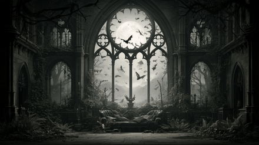
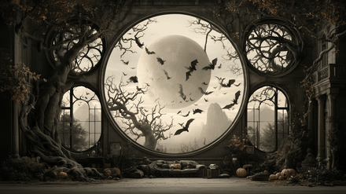
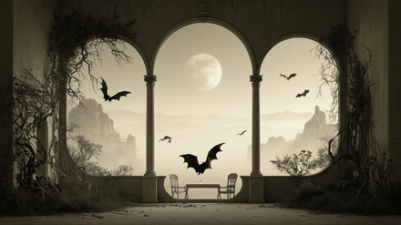
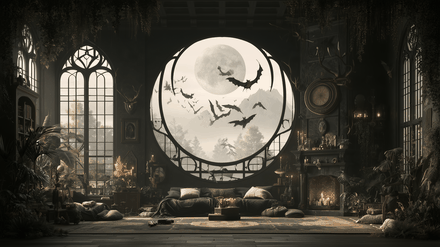
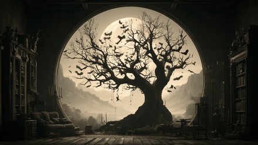
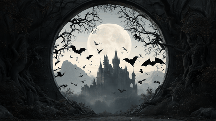

# Bauhaus-Lugosi

Warm charcoal, parchment and candle amber: a sepia goth theme for all year round.


## Install

```
omarchy theme install https://github.com/drkaolin/omarchy-bauhaus-lugosi-theme
```

Or use *Install > Style > Theme* in the Omarchy menu (Super + Alt + Space).

## What's in it

- `colors.toml` — the palette, with the `color0`–`color15` names Omarchy 3.8 expects alongside the Omarchy 4 names.
- `icons.theme` — `Yaru-wartybrown` file manager icons.
- `backgrounds/` — six moonlit gothic scenes.
- `unlock.png` — a moon-and-bat rose window for the boot unlock screen. Pick it under *Style > Unlock*.
- App configs rendered from `colors.toml` with Omarchy's own templates:
  - Omarchy 4: `shell.toml`, `hyprland.lua`, `neovim.lua`, `gum_env.lua`, `btop.theme`, `chromium.theme`, `helix.toml`, `obsidian.css`, `keyboard.rgb`, `vscode-theme.json`, `claude.json`, `hermes.yaml`, `pi.json`, `t3code.json`, `hyprland-preview-share-picker.css`
  - Terminals: `alacritty.toml`, `foot.ini`, `ghostty.conf`, `kitty.conf`
  - Omarchy 3.8: `hyprland.conf`, `hyprlock.conf`, `waybar.css`, `walker.css`, `mako.ini`, `swayosd.css`, `gum.env.conf`

When the theme is installed from git, Omarchy 4 drops the `.lua` files and terminal configs and regenerates them from `colors.toml`, so the result is the same.

If you change `colors.toml`, re-render these files so they stay in sync.

## Backgrounds

Click a thumbnail for the full-size image.

<table>
  <tr>
    <td><a href="backgrounds/1.png"></a></td>
    <td><a href="backgrounds/2.png"></a></td>
    <td><a href="backgrounds/3.png"></a></td>
  </tr>
  <tr>
    <td><a href="backgrounds/4.png"></a></td>
    <td><a href="backgrounds/5.png"></a></td>
    <td><a href="backgrounds/6.png"></a></td>
  </tr>
</table>

## Inspiration

An homage to:

* **"Bela Lugosi's Dead"** by Bauhaus (1979). Nine and a half minutes of echo and dread, often called goth's first anthem, and the reason for this theme's name.
* **Bela Lugosi's films**, above all *Dracula* (1931). Black-and-white castles, candlelit halls, a pale moon over the mountains and bats against the night sky. The palette is the silver screen gone sepia; the backgrounds are the kind of rooms and ruins he haunted.

Lugosi was born Béla Blaskó in Lugos, today's Lugoj in Romania, and took his stage name from his hometown.

## License

MIT for the theme files. The background images were generated with Midjourney and are not covered; see [LICENSE](LICENSE).
