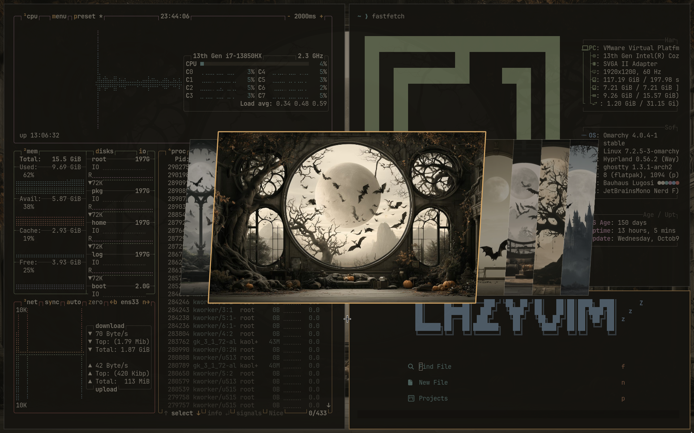
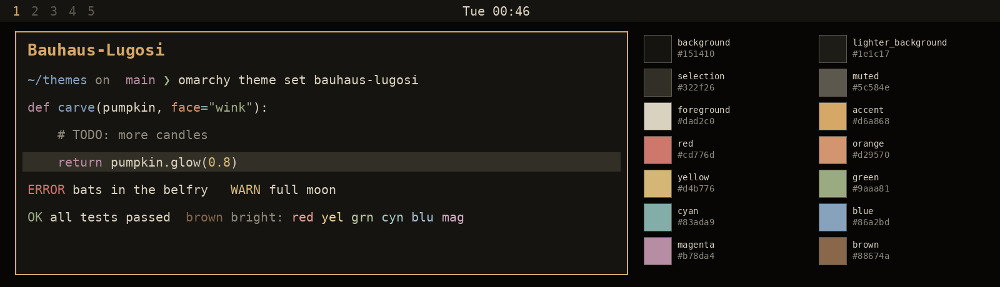

# Bauhaus-Lugosi

A year-round goth theme in sepia and bone: olive-charcoal blacks, parchment text and a single candle-amber accent, taken from its moonlit gothic backgrounds.





## Install

```
omarchy theme install https://github.com/drkaolin/omarchy-bauhaus-lugosi-theme
```

Or use *Install > Style > Theme* in the Omarchy menu (Super + Alt + Space).

## What's in it

- `colors.toml` — the palette, with the `color0`–`color15` names Omarchy 3.8 expects alongside the Omarchy 4 names.
- `icons.theme` — `Yaru-wartybrown` file manager icons.
- `backgrounds/` — six moonlit gothic scenes.
- `unlock.png` — a moon-and-bat rose window for the boot unlock screen. Pick it under *Style > Unlock*.
- App configs rendered from `colors.toml` with Omarchy's own templates:
  - Omarchy 4: `shell.toml`, `hyprland.lua`, `neovim.lua`, `gum_env.lua`, `btop.theme`, `chromium.theme`, `helix.toml`, `obsidian.css`, `keyboard.rgb`, `vscode-theme.json`, `claude.json`, `hermes.yaml`, `pi.json`, `t3code.json`, `hyprland-preview-share-picker.css`
  - Terminals: `alacritty.toml`, `foot.ini`, `ghostty.conf`, `kitty.conf`
  - Omarchy 3.8: `hyprland.conf`, `hyprlock.conf`, `waybar.css`, `walker.css`, `mako.ini`, `swayosd.css`, `gum.env.conf`

When the theme is installed from git, Omarchy 4 drops the `.lua` files and terminal configs and regenerates them from `colors.toml`, so the result is the same.

If you change `colors.toml`, re-render these files so they stay in sync.

## Backgrounds

1. Gothic cathedral window, full moon and bats, overgrown hall
2. Round moon window with a twisted tree
3. Three arches over misty mountains
4. Round moon window in a candlelit parlour
5. Dead tree inside a round window, library
6. Castle and bats through a round stone arch

To make more in the same style, use one of these prompts and add an existing background as a style reference with `--sref <image-url>`. Upscale, save into `backgrounds/` as the next number, for example `7.png`.

```
sepia and bone monochrome gothic interior, a huge round window framing a pale full moon, bats drifting across a misty valley with craggy mountains, overgrown vines and bare twisted branches, dusty victorian furniture in deep shadow, parchment-white light, olive-charcoal blacks, matte painting, soft volumetric light, calm center --ar 16:9 --style raw --no text, letters, watermark, signature, frame
```

```
sepia and bone monochrome gothic arcade, tall pointed tracery windows, a pale moon behind fog, bats in silhouette, ivy and ferns on stone, a single candle glowing amber, olive-charcoal shadows, matte painting, quiet and symmetrical --ar 16:9 --style raw --no text, letters, watermark, signature, frame
```

## Inspiration

A homage to:

- **"Bela Lugosi's Dead"** by Bauhaus (1979), the song that gave goth its first anthem, and this theme its name.
- **Mary Shelley**, author of *Frankenstein*, for gothic romance by candlelight.
- **The Sandman**, the TV series, for its moonlit, dreamlike gloom.

## License

MIT for the theme files. The background images were generated with Midjourney and are not covered; see [LICENSE](LICENSE).
